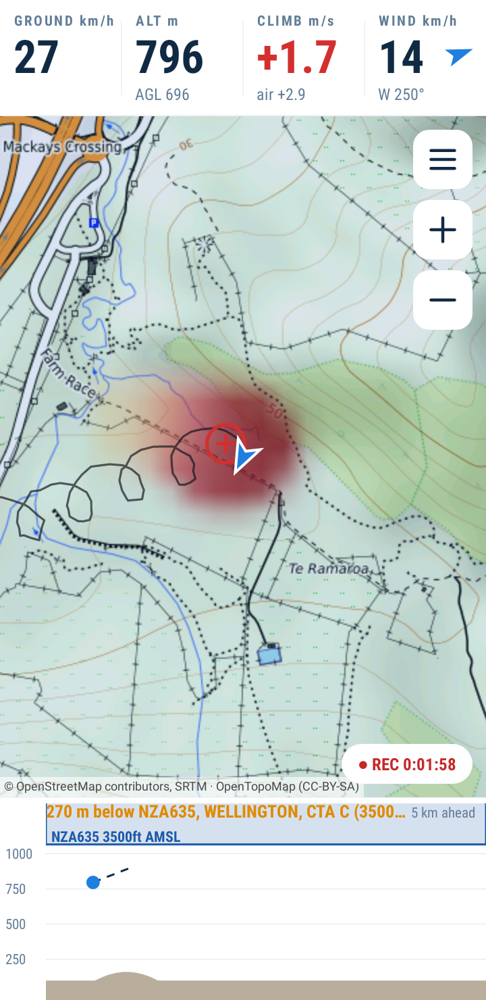
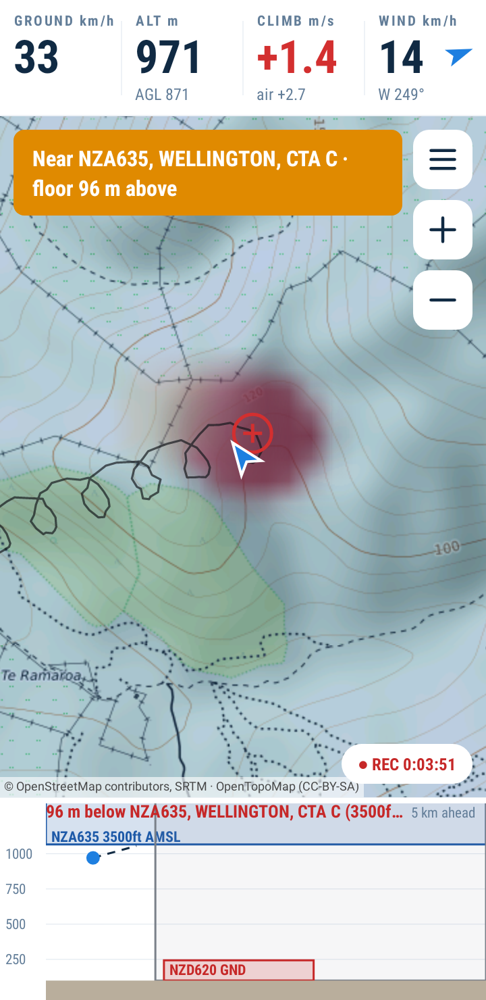
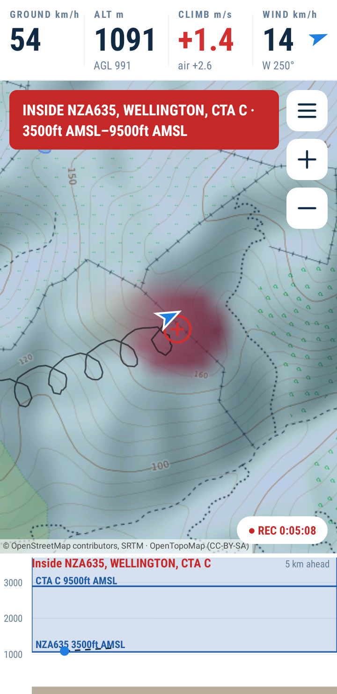
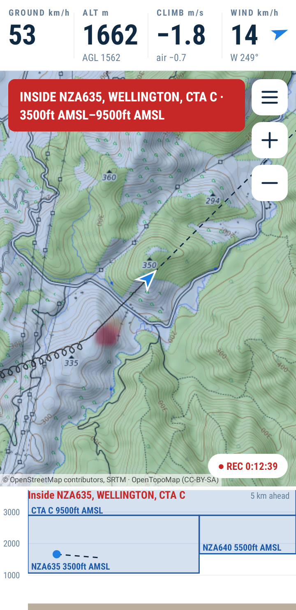

# Cloudbase


A paragliding flight instrument for an Android phone: moving terrain map, ground speed,
altitude, climb, wind, airspace on the map and from the side with alerts before you breach it,
a lift/sink heat map for centring thermals, and IGC flight logs that start and stop by
themselves. Set up for New Zealand; other countries' airspace is one tap away.

| Thermalling | Airspace warning | Inside airspace | On glide |
|---|---|---|---|
|  |  |  |  |

(Screenshots are the built-in demo flight, rendered by `make screenshots`.)

## Install

Plug the phone in over USB with USB debugging on, then:

```sh
make install
```

That finds (or downloads) the Android SDK, builds a release APK, installs it with its
permissions granted, exempts it from battery optimisation and opens it. Needs JDK 17+ and
Android 8 or newer. `make` lists the other targets (`test`, `screenshots`, `logs`…).

First launch, with a data connection: it downloads New Zealand airspace by itself. Then open
**≡ → Offline maps**, frame your flying area on the map, and download it, so the map and
terrain work with no signal. **≡ → Settings → Demo flight** flies a simulated flight so you can
see everything working on the ground.

## What's on screen

**Top row.** Ground speed, altitude above sea level (and above ground), climb rate (and the
vertical speed of the air itself), wind speed and direction with an arrow showing which way it
is carrying you on the map.

**Map.** North-up topographic map. Airspace you must stay out of is outlined blue (controlled)
or red (restricted, danger, military); informational airspace is thin grey. Press and hold on an
airspace for its limits, or to ignore it. **Tap the map once to zoom in, twice to zoom out**
(made for gloves; the + and − buttons and pinch work too). The coloured cloud is the **thermal map**: warm where the air was
rising (amber for weak lift through to deep red for strong), cool where it was sinking (pale to
deep blue), drifting downwind with the air; the red ring marks the best lift nearby. That drift only lasts
five minutes, long enough to centre the climb you are in. After that a patch is shown, faded,
at the ground location where you met it, and stays there for the rest of the flight: thermals
come off terrain, so the place is what is worth remembering. The map **zooms in close when you start circling** and back out when you leave.
The dashed line ends in an **×** where your present glide meets the ground (while climbing it
shows where you will be in a minute instead).

**Side view.** A slice through the air along your direction of travel: terrain, airspace as
blocks at their real heights, your projected path, and the headline number — how far below the
next airspace floor you are. It shows from the ground to just past the next boundary above you
(the floor overhead, or the top of the airspace you are in) and opens up as you cross each one. Tap to change the range (2, 5, 10 km).

**Alerts.** A banner, a tone and (optionally) a spoken warning when you are *near* an airspace
(amber), *about to enter* one on your present track and climb (red, with seconds to go), or
*inside* one. Margins and look-ahead time are in Settings.

**Flight log.** Starts at takeoff and stops at landing. Files are in **≡ → Flights**; tap one
to share or upload it.

## How it works, and how far to trust it

- **Altitude.** Android reports height above the WGS84 ellipsoid, not sea level. It is
  corrected using, in order of preference, the phone's own sea-level altitude (Android 14+),
  the geoid height reported by the GPS chipset, or a built-in 1° EGM96 grid (within ~1 m over
  95 % of NZ, 2.6 m worst case). With a barometer, a Kalman filter fuses pressure altitude and
  the accelerometer for a fast, smooth climb rate, and tracks GPS slowly for the absolute
  value. Flight levels are compared against pressure altitude directly, as they are defined.
- **Wind.** Ground velocity = air velocity + wind, so as you turn, your ground-velocity
  vectors trace a circle whose centre is the wind. After about a full circle the app fits that
  circle and gets wind *and* true airspeed with no assumptions. Before that, from gentler
  turns, it assumes your trim speed (Settings) — shown with a `?` because it is a weaker
  estimate. Flying straight tells it nothing. Uneven turning (bank or turn rate wandering,
  lopsided circles, reversing) does not affect it; flying consistently faster on one side of
  every circle than the other does, one for one (1 m/s faster heading north and 1 m/s slower
  heading south reads as 1 m/s of wind), because from the ground the two are the same thing.
- **Thermal map.** Air-mass climb = your climb + the glider's own sink (more when banked).
  It only knows about air you have flown through.
- **Glide line.** Uses your glide ratio *over the ground* for the last several seconds, so it
  already includes wind and the air you are in. It says nothing when terrain data for the path
  is missing.
- **Airspace data** is openAIP's public export (CC BY-NC 4.0), no account needed. It is **not
  an official source**: check the AIP and NOTAMs. For New Zealand the app classifies by
  designator, because the export's class field is unreliable there:
  `NZA` controlled, `NZR` restricted, `NZM` military, `NZD` danger and `NZV` volcanic → alert;
  `NZB` mandatory broadcast zones → shown, alert optional (Settings); `NZG` general aviation
  areas → shown; `NZC` common frequency zones → hidden. The export has no low flying zones or
  parachute areas for NZ, and nothing says whether a general aviation area is active — the
  control area around an active one will still alert until you ignore it.
- **Limits above ground** need terrain data. Where a tile has not been downloaded, an
  airspace *ceiling* given as height above ground is measured from sea level instead, which
  can understate it. Download your area first.
- **IGC files** have no validation (G) record — that needs a key issued to approved
  manufacturers — so competitions that require validated logs will not accept them. GPS
  altitude is logged as sea-level altitude and declared so (`HFALGALTGPS:GEO`).
- **Takeoff** is detected when you are moving and at least 15 m above the terrain (so the
  drive up does not start a log); **landing** after 20 s at rest near the ground. Hovering low
  and motionless into wind for 20 s can end a log early; a new one starts when you move.
  Manual start/stop is in **Flights**.
- **Not yet flown.** Everything is tested against a flight simulator and real NZ airspace
  files, not yet against a real flight. The vario and wind tuning in particular want real
  logs. Treat it as an aid, not as the thing keeping you legal or safe.

## Built to be light

- No map SDK, AppCompat, Material or XML layouts: framework views drawn in code. The APK is
  under 300 KB.
- The screen repaints once per GPS fix, never on a free-running timer. GPS at 1 Hz, barometer
  at 20 Hz, accelerometer at 25 Hz; no gyroscope, no network location.
- Map tiles are picked a level or two coarser on high-density screens (legible labels, a
  quarter of the downloads) and held in a 24 MB memory cache. On disk they are a
  least-recently-used cache with a size limit (500 MB by default, **Offline maps**): your usual
  sites stay, places you looked at once are the first to go. Terrain heights are always kept.
- One background service owns the sensors, holds a wake lock only while airborne, and stops
  itself after an hour on the ground with the screen off or the app closed (reopening the app
  starts it again).

## Layout

- `core/` — pure Kotlin, no Android, all the logic that can be wrong in the air: OpenAir
  parser, airspace geometry and alerting, vario filter, wind, thermal map, flight detection,
  IGC, geoid, and `FlightComputer`, which ties them together. `./gradlew :core:test` (245
  tests) includes whole simulated flights through the full pipeline.
- `app/` — Android: `FlightService` (GPS, sensors, demo), `map/` (tile view, cache, terrain
  elevation), `ui/` (instruments, overlays, side view, settings pages).
- `tools/make_geoid.py` regenerates the geoid grid from the NGA EGM96 data.

Map © OpenStreetMap contributors, SRTM; map style © OpenTopoMap (CC-BY-SA). Terrain: Mapzen
terrain tiles on AWS. Airspace: openAIP.
